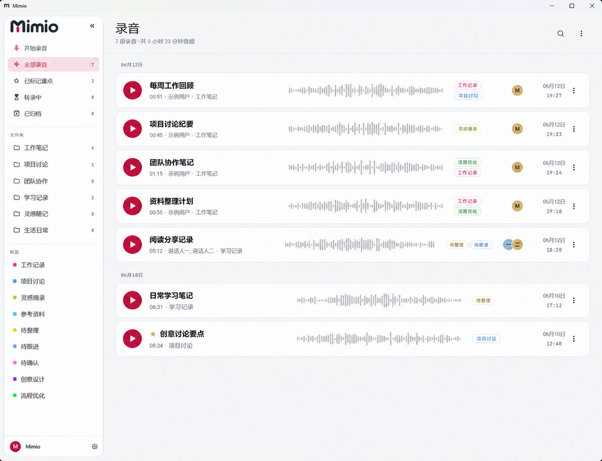
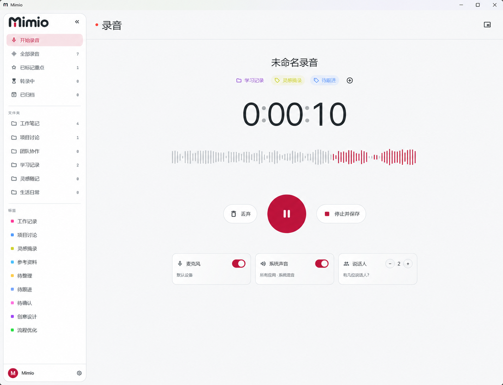

<p align="center"></p>

# Mimio · Speakr on your desktop

A Windows companion for recording, reviewing and organizing audio with your own [Speakr](https://github.com/murtaza-nasir/speakr) server. A compact recorder when you need space; a full workspace when you need the details.

**[简体中文](README.zh-CN.md)** · **[Download](https://github.com/i-iooi-i/Mimio/releases)** · **[Speakr documentation](https://murtaza-nasir.github.io/speakr/)** · **[MIT license](LICENSE)**

Mimio is an independently maintained desktop client based on [Minutes for Speakr](https://github.com/Inrego/Minutes-for-Speakr). It is not an official Speakr client and is not maintained or endorsed by the Speakr team. You need your own Speakr server and API token; transcription and AI features are provided by that server.

## A look at Mimio

Based on actual Mimio screenshots, with recording titles, names, folder/tag labels and the personal avatar replaced using AI for privacy. The images retain the application's layout and theme; AI editing may introduce minor rendering differences.

**Recording library** — browse and organize your recordings.



**Recording workspace** — recording controls, waveform and audio source selection.



## Version status

| | Version | What it contains |
| --- | --- | --- |
| Current source | **0.3.36** | Recorder capsule, theme consistency, server settings synchronization and credential privacy fixes |
| Published Windows download | **[0.3.26](https://github.com/i-iooi-i/Mimio/releases/tag/mimio-v0.3.26)** | The previous portable release, including the Windows location-startup fix |

The features below describe the current source. A source update does not replace the downloadable release. Mimio currently validates **Windows x64**; Android/iOS code inherited from upstream is not a verified Mimio release.

## What you can do

- **Record without a crowded desktop.** Capture the microphone and supported system audio sources, pause/resume, stop and save, or return to the main window from a compact capsule. The recorder and main window alternate instead of staying visible together.
- **Keep recordings organized.** Search the library, use folders and tags, review transcripts, summaries and notes, and ask questions about recordings through your server.
- **Make the workspace yours.** Simplified Chinese and English, light/dark/system appearance, theme colors, shared rounded controls, and an optional device-local avatar image URL.
- **Change useful server settings here.** Read and update automatic summarization. Configure per-folder transcription language, speaker-count limits and summary instructions, where the server API and account permissions support them. Saves are read back for verification; use refresh to pick up changes made elsewhere.
- **Choose your automation.** Optional automatic recording and watched-folder uploads are inherited from upstream. Review their settings before enabling them: successful automatic uploads can delete the local source file.

## Get started

1. Set up a reachable Speakr server and create an API token in its settings. Grant the permissions needed for the actions you intend to use.
2. Download the Windows ZIP from this repository's [Releases](https://github.com/i-iooi-i/Mimio/releases). Check its `SHA256SUMS.txt`, extract the complete folder and run `speakr_app.exe`.
3. Enter your server address and API token. Use the final server address: authenticated API requests do not automatically follow redirects.
4. Select your recording sources and start recording. Processing, summaries and other AI capabilities depend on your server configuration.

Windows builds are currently unsigned. Keep a backup of the old application directory before upgrading; do not copy only the executable out of the portable folder.

## What stays local, what reaches the server

| Data or setting | Location / behavior |
| --- | --- |
| Server address and API token | OS secure storage; used to connect to your selected Speakr server |
| Appearance, language and avatar URL | This device; the avatar is fetched from the image host you choose and does not update the Speakr profile |
| Recordings submitted for processing, transcripts and AI results | Your Speakr server; processing may use providers configured by its administrator |
| Automatic summary and folder defaults | Saved to Speakr through supported APIs, with read-back verification |

Public packages must contain application files only, not personal credentials, avatar links, recordings or local preferences. Upgrading under the same Windows account may reuse existing device settings; this does not mean they were bundled in the download. Never publish AppData, private logs or an already-used application directory.

## Build from source

Use Flutter/Dart compatible with `pubspec.yaml`, and Visual Studio 2022 C++ build tools including ATL for Windows.

```sh
flutter pub get
dart run build_runner build --delete-conflicting-outputs
flutter analyze
flutter test
flutter build windows --release
```

The complete output is in `build/windows/x64/runner/Release/`. For public builds, use a clean, neutral build path and scan the output for personal paths and secrets before packaging. The inherited release workflow and installer still use upstream naming; do not treat them as a ready-to-run Mimio publishing pipeline.

The latest local review passed static analysis, **152 tests**, and a clean Windows release build. This is a recorded local result, not a promise that every platform or server configuration has been tested. See [shared controls](docs/mimio-controls.md) and [contributor guidance](AGENTS.md).

## Community and credits

- **Speakr:** [server project](https://github.com/murtaza-nasir/speakr) and [unofficial companion-app guide](https://murtaza-nasir.github.io/speakr/user-guide/companion-apps/).
- **Upstream client:** [Minutes for Speakr](https://github.com/Inrego/Minutes-for-Speakr), by Rene Scott Simonsen and contributors.
- **Mimio:** desktop interface, localization, recorder and settings improvements maintained in this repository.

The companion-app guide currently lists the upstream client, not Mimio. Linking to it does not imply an official listing or endorsement. Report client-specific problems to this repository, with the version, Windows version and reproduction steps. Remove server addresses, tokens, avatar links and personal recording content from screenshots and logs before sharing them.

Distributed under the [MIT license](LICENSE). The original copyright notice and bundled third-party license notices are preserved. Older screenshots and store documents in `docs/` describe the upstream application and are retained as reference; they are not screenshots of the current Mimio interface.
