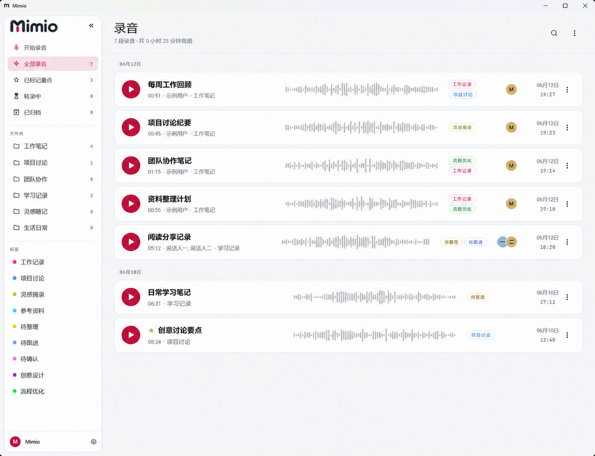
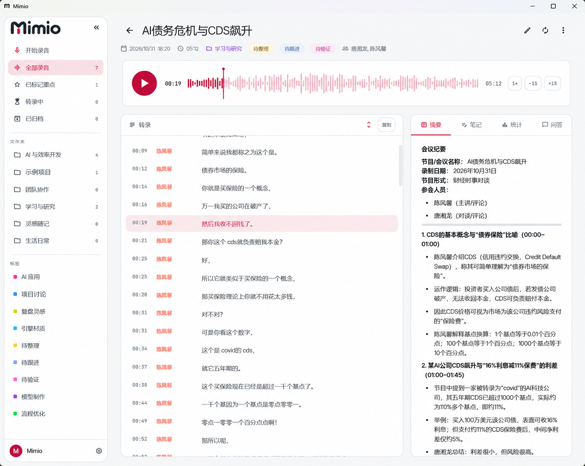
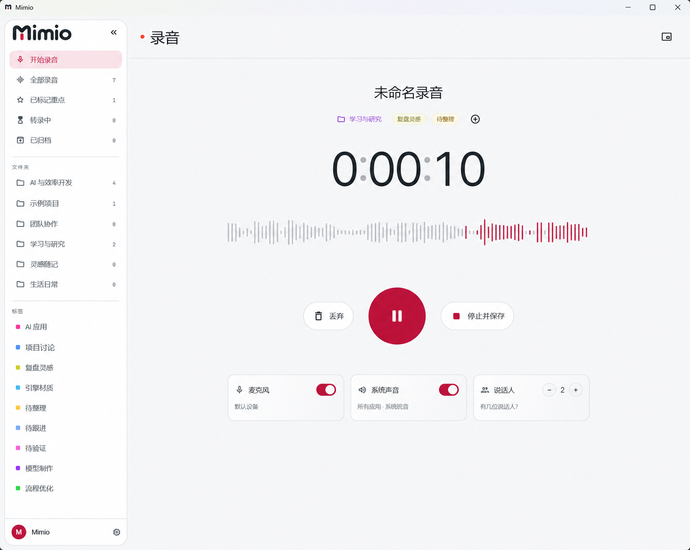

<p align="center"></p>

# Mimio · 把 Speakr 带到桌面

连接你自己的 [Speakr](https://github.com/murtaza-nasir/speakr) 服务，在 Windows 上录音、整理资料、阅读转录与摘要。录音时用小巧的胶囊控制，整理时回到完整工作区。

**[English](README.md)** · **[下载](https://github.com/i-iooi-i/Mimio/releases)** · **[Speakr 文档](https://murtaza-nasir.github.io/speakr/)** · **[MIT 许可证](LICENSE)**

Mimio 是基于 [Minutes for Speakr](https://github.com/Inrego/Minutes-for-Speakr) 开发的社区分支，不是 Speakr 官方客户端，也不由 Speakr 团队维护或背书。使用前需要准备自己的 Speakr 服务器和 API 令牌；转录及 AI 功能由服务端提供。

## 界面一览

以下图片基于 **Mimio 0.3.40 真实截图**，使用 AI 替换个人账号名、工作项目名称和个人头像。经截图提供者确认，公开节目的转录与摘要予以保留。AI 编辑可能带来少量渲染差异。

**录音库** · 浏览和整理录音资料。



**转录与摘要** — 对照查看转录内容与生成的摘要。



**录音工作区** · 录音控制、实时波形和声音来源选择。



## 当前版本

| | 版本 | 说明 |
| --- | --- | --- |
| 当前源码 | **0.3.41** | 胶囊录音条、主题统一、服务端设置同步与凭据隐私修复 |
| 已发布的 Windows 下载 | **[0.3.41](https://github.com/i-iooi-i/Mimio/releases/tag/mimio-v0.3.41)** | 由 GitHub Actions 构建，附带校验和与来源证明；界面沿用 0.3.40 |

以下功能介绍以当前源码为准。推送源码不等于更新下载包。本分支目前验证的是 **Windows x64**；仓库保留上游 Android/iOS 代码，但没有将其作为已验证的 Mimio 移动端发布。

## 可以做什么

- **录音时少占桌面。** 选择麦克风及支持的系统声音来源，通过胶囊控制条暂停、继续、结束保存，或返回主窗口。胶囊与主窗口交替显示。
- **集中整理录音资料。** 搜索录音，管理文件夹和标签，查看转录、摘要、笔记，并通过服务端对录音内容提问。
- **让界面适合自己。** 简体中文与英文切换，浅色、深色、跟随系统，主题配色与共用圆角控件，也可以填写图片直链作为本地头像。
- **常用服务端设置直接修改。** 读取和修改自动摘要；为文件夹设置默认转录语言、说话人数范围和摘要要求。以服务器接口及账号权限支持为准，保存后重新读取核对；网页端改动可通过刷新重新获取，并非实时推送。
- **按需开启自动化。** 保留上游自动录音与文件夹自动上传功能。开启前请阅读设置说明：自动上传成功后可能删除本机源文件。

## 开始使用

1. 准备可访问的 Speakr 服务，在服务端设置中创建 API 令牌，并赋予所需操作权限。
2. 从本仓库 [Releases](https://github.com/i-iooi-i/Mimio/releases) 下载 Windows ZIP，核对 `SHA256SUMS.txt` 后完整解压，运行 `speakr_app.exe`。
3. 填写服务器地址和 API 令牌。请使用最终服务地址，携带认证的 API 请求不会自动跟随跳转。
4. 选择录音来源并开始录音。转录、摘要等能力取决于你的服务端配置。

Windows 程序目前未签名。升级前保留旧程序备份，不要只复制 EXE，整个解压目录都需要保留。

## 数据保存在哪里

| 数据或设置 | 保存位置与行为 |
| --- | --- |
| 服务器地址、API 令牌 | 系统安全存储，用于连接你选择的 Speakr 服务 |
| 外观、语言、本地头像地址 | 当前设备；头像从你指定的图片服务加载，不修改 Speakr 账号头像 |
| 提交处理的录音、转录和 AI 结果 | Speakr 服务端；处理可能使用管理员配置的外部服务 |
| 自动摘要、文件夹默认设置 | 通过支持的 API 保存到 Speakr，并重新读取确认 |

公开包只应包含应用文件，不附带个人服务器地址、令牌、头像链接、录音或用户设置。同一 Windows 账号升级后读取到旧设置，是复用了本机配置，并不代表这些配置包含在下载包中。请勿上传 AppData、私人日志或已经使用过的安装目录。

## 从源码构建

使用满足 `pubspec.yaml` 要求的 Flutter/Dart；Windows 需要 Visual Studio 2022 C++ 构建工具及 ATL。

```sh
flutter pub get
dart run build_runner build --delete-conflicting-outputs
flutter analyze
flutter test
flutter build windows --release
```

完整产物位于 `build/windows/x64/runner/Release/`。Windows 绿色版由 [公开发布工作流](.github/workflows/release.yml) 构建：固定 Flutter 3.47.8、锁定依赖、代码分析、测试、构建、打包、来源证明和发布包下载回验。推送与源码版本一致的 `mimio-vX.Y.Z` 标签即可触发；手动运行只生成测试产物，不发布版本。

新版发布附带 `SHA256SUMS.txt`、`BUILD-INFO.json` 和 GitHub 构建来源证明。验证方法见 [发布说明](docs/windows-release.md)。这说明发布包来自对应的公开工作流，不代表 Windows 代码签名或功能安全认证。

共用控件说明见 [界面控件文档](docs/mimio-controls.md)，开发说明见 [AGENTS.md](AGENTS.md)。

## 项目关系与反馈

- **Speakr：** [服务端项目](https://github.com/murtaza-nasir/speakr)及[非官方配套应用说明](https://murtaza-nasir.github.io/speakr/user-guide/companion-apps/)。
- **上游客户端：** [Minutes for Speakr](https://github.com/Inrego/Minutes-for-Speakr)，由 Rene Scott Simonsen 及贡献者开发。
- **Mimio：** 在本仓库维护桌面界面、汉化、录音交互和设置功能改进。

Mimio 独立维护；社区收录不表示 Speakr 团队测试或背书。反馈客户端问题时，请附上版本、Windows 版本和复现步骤，分享截图与日志前移除服务器地址、令牌、头像链接和私人录音内容。

本项目使用 [MIT 许可证](LICENSE)，保留原作者版权及第三方许可声明。`docs/` 中的旧截图和商店说明作为上游历史参考保留，不代表当前 Mimio 界面。
